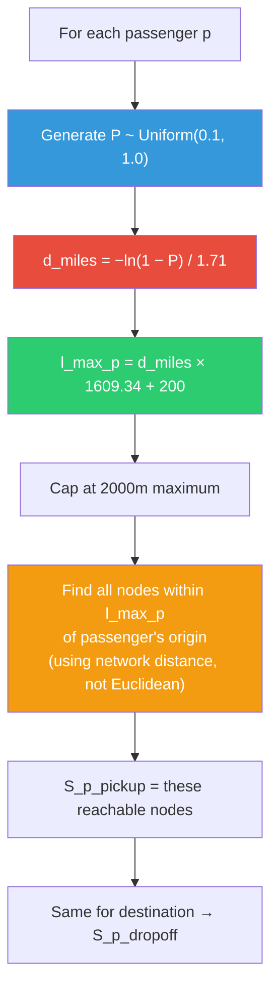

# Understanding the Distance Decay Function — Step by Step

---

## What was highlighted in the paper

The exact highlighted text from page 4 of the paper is:

> *"The walk flexibility distribution is computed using the distance decay function*
> *d = log_e(1−P) / β, where d is distance in miles, P = e^(−βd), and β = 1.71*
> *as suggested by Yang and Diez-Roux [16]. To ensure a reasonable walking distance*
> *and accessibility to at least one junction from the source location, we generate P*
> *as a random number uniformly distributed in the range of [0.1, 1.0] and add 200*
> *meters to the value of d."*

This looks complex but it's actually straightforward. Let me break it down.

---

## The Core Idea (No Math)

Think of it this way: **people are less willing to walk as the distance increases**. 

- Almost everyone is willing to walk 100 meters
- Most people are willing to walk 300 meters
- Fewer people are willing to walk 500 meters
- Very few people are willing to walk 1000 meters

This "willingness" drops off in a **decay** pattern — not linearly (evenly), but **exponentially** (sharply at first, then gradually). That's why it's called a **distance decay function**.

Instead of giving every passenger the same fixed maximum walking distance (currently `L_MAX = 600m` for everyone), the paper says: **each passenger should get a different walking limit based on this realistic decay pattern**.

---

## The Formula — Broken Down

There are really just **two equations** that are inverses of each other:

### Equation A: "How willing is someone to walk distance d?"

```
P = e^(−β × d)
```

| Symbol | Meaning |
|--------|---------|
| `P` | Probability/willingness to walk (ranges from 0 to 1) |
| `d` | Walking distance (in miles) |
| `β` | Decay rate = **1.71** (from research by Yang & Diez-Roux) |
| `e` | Euler's number ≈ 2.718 |

**What this says:** As distance `d` increases, `P` decreases. The higher `β` is, the faster the willingness drops.

### Equation B: "Given a willingness P, what distance does that correspond to?"

This is just Equation A solved for `d`:

```
d = −ln(1 − P) / β
```

or equivalently:

```
d = ln(1 − P) / (−β)
```

| Symbol | Meaning |
|--------|---------|
| `d` | The resulting walking distance (in miles) |
| `ln` | Natural logarithm (log base e) |
| `P` | A random number we generate |
| `β` | 1.71 (same constant) |

> [!NOTE]
> **The paper uses Equation B** — they generate a random `P`, plug it in, and get a distance `d`. That distance becomes the passenger's personalized **walk flexibility** (how far they're willing to walk).

---

## The Algorithm — Step by Step

Here's exactly what the paper does for **each passenger**:

### Step 1: Generate a random willingness `P`

```
P = random uniform number between 0.1 and 1.0
```

Why 0.1 to 1.0 (not 0.0 to 1.0)? Because if `P` is very close to 0, the formula gives an extremely small walking distance (almost zero), which means the passenger can barely reach any junction. By starting at 0.1, they ensure everyone is at least somewhat willing to walk.

### Step 2: Plug `P` into the formula to get distance `d`

```
d = −ln(1 − P) / 1.71
```

This gives `d` **in miles**.

### Step 3: Convert to meters and add a baseline

```
d_meters = d × 1609.34        (miles → meters)
d_meters = d_meters + 200     (add 200m baseline)
```

The +200 meters ensures that **every passenger can reach at least one junction** even if their random `P` is low.

### Step 4: This `d_meters` becomes the passenger's `l_max`

Instead of the fixed `L_MAX = 600m`, each passenger now has their own personalized `l_max_p`.

---

## Numerical Examples

Let me show you what this produces for different values of `P`:

| P (random) | −ln(1 − P) | d (miles) = −ln(1−P)/1.71 | d (meters) | + 200m baseline | Final l_max |
|:---:|:---:|:---:|:---:|:---:|:---:|
| 0.10 | 0.105 | 0.062 | 99 m | 299 m | **299 m** |
| 0.20 | 0.223 | 0.130 | 210 m | 410 m | **410 m** |
| 0.30 | 0.357 | 0.209 | 336 m | 536 m | **536 m** |
| 0.40 | 0.511 | 0.299 | 481 m | 681 m | **681 m** |
| 0.50 | 0.693 | 0.405 | 652 m | 852 m | **852 m** |
| 0.60 | 0.916 | 0.536 | 862 m | 1062 m | **1062 m** |
| 0.70 | 1.204 | 0.704 | 1133 m | 1333 m | **1333 m** |
| 0.80 | 1.609 | 0.941 | 1514 m | 1714 m | **1714 m** |
| 0.90 | 2.303 | 1.347 | 2168 m | 2368 m | **2368 m** |
| 1.00 | ∞ | ∞ | ∞ | ∞ | (capped) |

> [!IMPORTANT]
> **Key insight from the table:**
> - Most passengers (P between 0.1 and 0.5) get walk flexibility of **300–850 meters**
> - Some passengers (P between 0.5 and 0.8) are willing to walk **850–1700 meters**
> - Very few passengers (P near 0.9+) get very large values — these would be capped in practice
> 
> Since `P` is uniform random, about **50% of passengers** will have `l_max` below ~850m, and **80%** will be below ~1700m.

### Compare with current code:
Our current code gives **every single passenger** `L_MAX = 600m`. The decay function instead gives a **realistic distribution** — some passengers walk less (299m), some walk more (1333m), reflecting real human behavior.

---

## How This Fits Into Our Model

### Current flow (file1.py):

```
Every passenger → L_MAX = 600m (fixed)
                → nodes_within_radius(origin_node, 600, node_coords)
                → S_p_pickup = [all nodes within 600m Euclidean]
```

### New flow with decay function:

```
Every passenger → Generate random P ~ Uniform(0.1, 1.0)
                → d = −ln(1 − P) / 1.71       (miles)
                → l_max_p = d × 1609.34 + 200  (meters)
                → Cap l_max_p at some maximum (e.g., 2000m)
                → nodes_within_radius(origin_node, l_max_p, node_coords)
                → S_p_pickup = [all nodes within l_max_p of origin]
```

### Where exactly in file1.py this goes:

Currently at [file1.py:L37](file:///home/viswa-vignan/Documents/SUMO_LMC/Dynamic_SIM_1/file1.py#L37):
```python
L_MAX = 600.0    # ← this fixed constant would be REMOVED
```

And at [file1.py:L229–L266](file:///home/viswa-vignan/Documents/SUMO_LMC/Dynamic_SIM_1/file1.py#L229-L266), inside the `for idx, row in df.iterrows():` loop:
```python
# Currently:
s_pickup = nodes_within_radius(origin_node, L_MAX, node_coords)

# Would become:
P = random.uniform(0.1, 1.0)
d_miles = -math.log(1 - P) / 1.71
l_max_p = d_miles * 1609.34 + 200.0
l_max_p = min(l_max_p, 2000.0)  # safety cap
s_pickup = nodes_within_radius(origin_node, l_max_p, node_coords)
```

Each passenger would then store their own `l_max` in the JSON:
```python
passengers.append({
    ...
    "l_max": l_max_p,    # ← personalized, not fixed 600
    ...
})
```

---

## Visual Flow



---

## What About the Walking Speed?

The paper also mentions:

> *"The walking speed of each commuter is generated using a Gaussian distribution with mean μ = 1.24 m/s and standard deviation σ = 0.1"*

This converts walking **distance** to walking **time**:

```
walking_time = l_max_p / walking_speed

Example: passenger with l_max_p = 600m and speed = 1.24 m/s
walking_time = 600 / 1.24 = 484 seconds ≈ 8 minutes
```

In our model, we currently don't use walking time explicitly — we use walking distance in the cost function. But if we later want to model actual pedestrian walking in SUMO (via `traci.person`), we'd need this speed to set realistic walking durations.

---

## Important Note: Network Distance vs Euclidean

The paper says `d(i, j)` is the distance from commuter `i` to junction `j`. In the paper's grid network (500m × 500m junctions), this is Manhattan/network distance.

When we implement the decay function, we should **also switch from Euclidean to network distance** for computing S_p_pickup. The Dijkstra function already exists in file1.py — we'd use it to find all nodes reachable within `l_max_p` meters via the actual road network, not by straight-line radius.

This is consistent with what you mentioned earlier about calculating **actual walking distance** rather than Euclidean.

---

## Summary

| Concept | Plain English |
|---|---|
| **What is the decay function?** | A formula that gives each passenger a realistic, different walking limit based on how real people behave |
| **What does β = 1.71 mean?** | It's a calibrated rate of how fast willingness to walk drops with distance (from real research data) |
| **What does P represent?** | A random "willingness score" — higher P = willing to walk farther |
| **Why add 200m?** | Safety baseline so even the least willing passenger can reach at least one nearby junction |
| **Why [0.1, 1.0] not [0.0, 1.0]?** | Avoids near-zero walking distances that would make the passenger unreachable |
| **Where does this go in our code?** | In `file1.py`, inside the passenger processing loop, replacing the fixed `L_MAX = 600m` |
| **What changes downstream?** | Each passenger's `S_p_pickup` and `S_p_dropoff` will have different sizes — some small (short walker), some large (long walker) |
