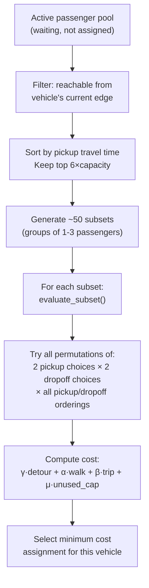

# Code Analysis — Passenger Spawning, Walking Model & Subset Questions

---

## Q1: Why are passengers not spawning/visible in the SUMO-GUI simulation?

> [!CAUTION]
> **Passengers are never actually placed in the SUMO simulation as person/pedestrian entities.** The current code treats passengers as **ghost entities** — they exist only as Python data structures (`Passenger` dataclass objects) and are never spawned as `traci.person` in SUMO.

### What actually happens:

1. **Vehicles** are real SUMO entities — spawned at [file2.py:L1286–L1305](file:///home/viswa-vignan/Documents/SUMO_LMC/Dynamic_SIM_1/file2.py#L1286-L1305) via `traci.vehicle.add()`.
2. **Passengers** are **purely logical** — they are tracked only in the Python dict `passengers_by_id`. Their "boarding" and "dropoff" are detected by checking if a vehicle **drives past a specific edge** ([file2.py:L671–L755](file:///home/viswa-vignan/Documents/SUMO_LMC/Dynamic_SIM_1/file2.py#L671-L755)).
3. **No `traci.person.add()` call exists anywhere** in the code. No walking routes are created for passengers via `traci.person.appendWalkingStage()` or similar.

### What sir asked — the "walking model":

To make passengers visible in SUMO-GUI, you would need to:
- Spawn each passenger as a SUMO `person` entity at their **selected pickup node** (not the original GPS location)
- Give them a walking stage from their **origin node → selected pickup node** (walking to the vehicle)
- Make them ride the vehicle
- Give them a walking stage from **selected dropoff node → final destination node** (walking from the vehicle)

> [!IMPORTANT]
> **This walking model is NOT currently implemented.** The code calculates walking *distances* as numbers, but never creates actual walking routes in SUMO.

---

## Q2: How is walking distance calculated?

Walking distance is calculated as **Euclidean (straight-line) distance** between network nodes — NOT as a network-routed walking path.

### The calculation chain:

**Step 1 — file1.py builds the feasible stop sets:** [file1.py:L119–L130](file:///home/viswa-vignan/Documents/SUMO_LMC/Dynamic_SIM_1/file1.py#L119-L130)

```python
def nodes_within_radius(center_node_id, radius, node_coords):
    cx, cy  = node_coords[center_node_id]
    result  = []
    for nid, (nx, ny) in node_coords.items():
        if math.hypot(cx - nx, cy - ny) <= radius:    # ← Euclidean distance
            result.append(nid)
    return result
```

This gives `S_p_pickup` and `S_p_dropoff` — all nodes within `L_MAX = 600 m` Euclidean radius of the origin/destination node.

**Step 2 — file2.py computes walking distance during assignment:** [file2.py:L326–L348](file:///home/viswa-vignan/Documents/SUMO_LMC/Dynamic_SIM_1/file2.py#L326-L348)

```python
def build_reduced_stop_choices(net, node_coords, passenger):
    pickup_choices = []
    for node in passenger.raw["S_p_pickup"]:
        edge = node_to_edge(net, node)
        walk_pick = euclid(node_coords, passenger.raw["origin_node"], node)  # ← Euclidean
        pickup_choices.append({"node": node, "edge": edge, "walk_pick": walk_pick})
    # ... same for dropoff ...
    pickup_choices.sort(key=lambda x: x["walk_pick"])
    # Keep only top MAX_STOP_CHOICES_PER_TYPE = 2 choices
```

**Step 3 — Total walking = pickup walk + dropoff walk:** [file2.py:L468–L469](file:///home/viswa-vignan/Documents/SUMO_LMC/Dynamic_SIM_1/file2.py#L468-L469)

```python
d_walk = current_assign[pid]["d_walk"] + drop_choice["walk_drop"]
if d_walk > float(p.raw["l_max"]):   # reject if total walk > 600m
    continue
```

### Summary of walking distance:
| Aspect | Current Implementation |
|---|---|
| **Distance metric** | Euclidean (`math.hypot`) — NOT actual walking network distance |
| **Pickup walk** | Euclidean distance from `origin_node` to the selected `pickup_node` |
| **Dropoff walk** | Euclidean distance from the selected `dropoff_node` to `dest_node` |
| **Total walk** | `walk_pick + walk_drop` |
| **Maximum allowed** | `L_MAX = 600 m` (the `l_max` constraint) |
| **Ideal walk** | `L_IDEAL = 0 m` (used in cost function penalty: `d_walk - l_ideal`) |

> [!WARNING]
> The walking distance is a **geometric estimate only**. The actual walking path on a street network would be longer (Manhattan distance ≈ √2 × Euclidean for a grid). No SUMO pedestrian routing is used.

---

## Q3: How are passengers spawned? Original trip location vs. subset selection?

### The flow is:

```
Original GPS location (CSV) 
    → Nearest SUMO grid node (origin_node / dest_node)
        → Feasible stop set S_p (nodes within 600m radius)
            → Optimization selects best pickup/dropoff from the set
```

### Specifically:

**1. Original GPS → Grid node (file1.py):** [file1.py:L229–L241](file:///home/viswa-vignan/Documents/SUMO_LMC/Dynamic_SIM_1/file1.py#L229-L241)

```python
px, py = gps_to_sumo_xy(row["pickup_longitude"], row["pickup_latitude"])
origin_node = nearest_node(px, py, node_coords)      # snapped to grid
dest_node   = nearest_node(dx, dy, node_coords)       # snapped to grid

s_pickup  = nodes_within_radius(origin_node, L_MAX, node_coords)  # the SET
s_dropoff = nodes_within_radius(dest_node,   L_MAX, node_coords)  # the SET
```

**2. During assignment, the optimizer selects from the set (file2.py):** [file2.py:L326–L348](file:///home/viswa-vignan/Documents/SUMO_LMC/Dynamic_SIM_1/file2.py#L326-L348)

- From `S_p_pickup` (the full set), it sorts by walking distance and keeps **only the 2 closest** (`MAX_STOP_CHOICES_PER_TYPE = 2`).
- From `S_p_dropoff`, same thing — **only the 2 closest**.
- The recursive evaluator ([file2.py:L392–L501](file:///home/viswa-vignan/Documents/SUMO_LMC/Dynamic_SIM_1/file2.py#L392-L501)) tries all combinations and selects the one with minimum cost.

### So the answer is: **BOTH**
- The **origin_node** (nearest grid node to the original GPS) is kept as the reference for walking distance calculation.
- The actual **pickup location** and **dropoff location** used in the vehicle route are selected **from the subset** `S_p_pickup` / `S_p_dropoff`, not the original GPS point.
- The passenger is **not placed at the original GPS location**; the passenger is not placed anywhere — they're ghost entities.

---

## Q4: How are passenger trips taken from the CSV? One trip = one passenger, or are `passenger_count` considered?

> [!CAUTION]
> **The `passenger_count` column from the NYC taxi CSV is completely ignored.** Each trip row in the CSV is treated as exactly **1 passenger**, regardless of how many passengers the actual taxi ride carried.

### Evidence:

**file0.py only keeps 5 columns:** [file0.py:L23–L29](file:///home/viswa-vignan/Documents/SUMO_LMC/Dynamic_SIM_1/file0.py#L23-L29)

```python
KEEP_COLS = [
    "tpep_pickup_datetime",
    "pickup_longitude",  "pickup_latitude",
    "dropoff_longitude", "dropoff_latitude",
]
```

The `passenger_count` column is **never read**. It is dropped during `pd.read_csv(usecols=KEEP_COLS)`.

**file1.py iterates one row = one passenger:** [file1.py:L229–L266](file:///home/viswa-vignan/Documents/SUMO_LMC/Dynamic_SIM_1/file1.py#L229-L266)

```python
for idx, row in df.iterrows():     # each CSV row = one passenger "p{idx}"
    ...
    passengers.append({
        "id": f"p{idx}",           # one ID per row
        ...
    })
```

### What the CSV actually contains (from your screenshot):

Looking at the CSV headers: `VendorID, tpep_pickup_datetime, tpep_dropoff_datetime, passenger_count, trip_distance, ...`

Examples from the screenshot data:
| Row | passenger_count |
|-----|----------------|
| Row 2 | 1 |
| Row 3 | 3 |
| Row 10 | 3 |
| Row 11 | 2 |
| Row 17 | 2 |
| Row 18 | 5 |
| Row 19 | 8 |

**All these multi-passenger trips are treated as single passengers in the code.** A taxi ride with `passenger_count=5` becomes just `p{idx}` — one passenger entity.

### Are multi-passengers placed in the same subset?

**No** — since each trip is a separate independent passenger, there is no concept of "these 5 passengers are traveling together." They become 5 separate trip rows (if they were separate rows), or in most cases, they're just one trip row with `passenger_count=5` which is treated as a single passenger.

The **subset** in the assignment (`sample_subsets` in [file2.py:L271–L311](file:///home/viswa-vignan/Documents/SUMO_LMC/Dynamic_SIM_1/file2.py#L271-L311)) groups **unrelated passengers** together for ride-sharing. The grouping is based on:
- Which passengers are currently in the active waiting pool
- Which ones are reachable from the vehicle's current position
- Which combination minimizes the objective function cost

---

## Q5: How is the subset for pickup of passengers created?

Per the PDF, the approach involves creating a feasible set of potential pickup/dropoff locations for each passenger, then selecting optimal assignments. Here's how the code implements this:

### Subset creation has TWO distinct layers:

### Layer 1: **Spatial feasibility set** (per-passenger, pre-computed in file1.py)

[file1.py:L239–L241](file:///home/viswa-vignan/Documents/SUMO_LMC/Dynamic_SIM_1/file1.py#L239-L241):
```python
s_pickup  = nodes_within_radius(origin_node, L_MAX, node_coords)   # all nodes within 600m
s_dropoff = nodes_within_radius(dest_node,   L_MAX, node_coords)   # all nodes within 600m
```

This creates `S_p_pickup` and `S_p_dropoff` — the **set of all possible stop locations** for each passenger. These are stored in `simulation_state.json` and loaded by file2.py.

### Layer 2: **Reduced stop choices** (at assignment time in file2.py)

[file2.py:L326–L348](file:///home/viswa-vignan/Documents/SUMO_LMC/Dynamic_SIM_1/file2.py#L326-L348):

From each passenger's full `S_p_pickup` (which could be dozens of nodes), only the **2 closest** to the origin are kept as choices. Same for dropoff — **2 closest** to the destination.

```
S_p_pickup (full set, ~20-50 nodes)  →  top 2 by walking distance  →  used in optimizer
```

### Layer 3: **Passenger grouping subset** (which passengers to assign together)

[file2.py:L271–L311](file:///home/viswa-vignan/Documents/SUMO_LMC/Dynamic_SIM_1/file2.py#L271-L311):

```python
def sample_subsets(candidate_pool, remaining_cap, n_subsets=50):
    # 1. Deterministic: try top-k nearest passengers (k=3,2,1)
    # 2. Random: 50 random groups, biased toward larger groups
```

The **candidate pool** is built in [file2.py:L557–L573](file:///home/viswa-vignan/Documents/SUMO_LMC/Dynamic_SIM_1/file2.py#L557-L573):
1. Filter: only passengers reachable from the vehicle's current edge
2. Sort by estimated pickup travel time (closest first)
3. Keep top `6 × remaining_capacity` candidates
4. Generate up to 50 random subsets of size 1 to `min(remaining_cap, 3)`

### Full assignment pipeline:



---

## Summary of Key Gaps

| Issue | Status in Code | What needs to change |
|---|---|---|
| **Passengers visible in SUMO-GUI** | ❌ Not implemented — ghost entities only | Need `traci.person.add()` + walking stages |
| **Walking model in SUMO** | ❌ Not implemented — Euclidean distance only | Need `traci.person.appendWalkingStage()` for origin→pickup and dropoff→dest |
| **`passenger_count` from CSV** | ❌ Completely ignored | Should either: (a) duplicate rows by `passenger_count`, or (b) keep as-is and treat each trip as a single demand unit |
| **Walking distance metric** | ⚠️ Euclidean approximation | Could use network-shortest-path for more accuracy |
| **Subset selection from PDF** | ✅ Implemented (feasible sets + top-2 reduction + 50 random subsets) | Matches the paper's approach conceptually, but with aggressive pruning for speed |
