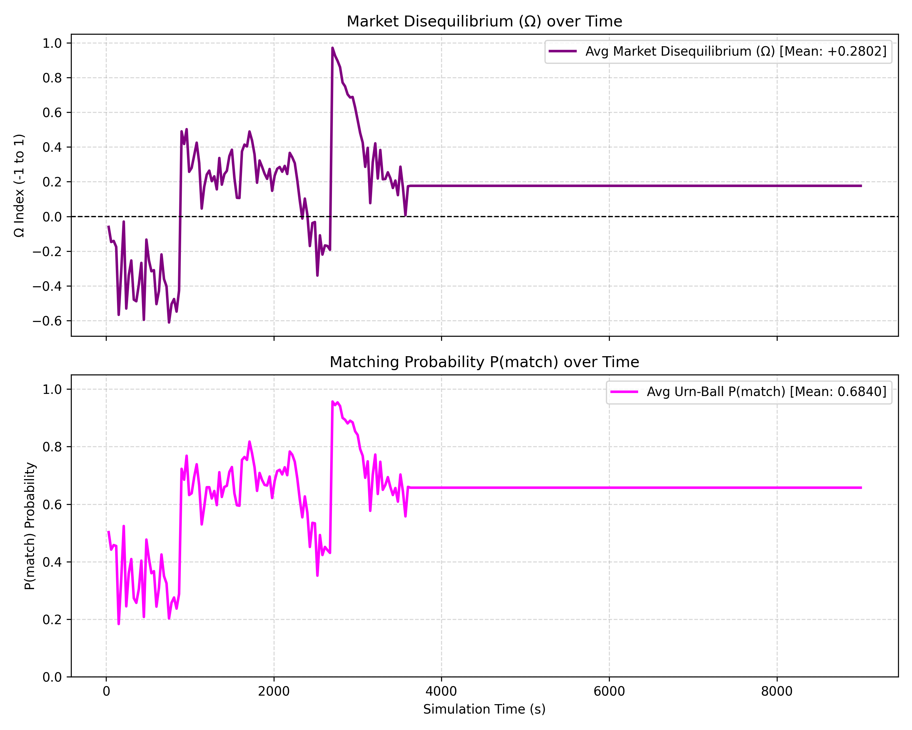

# 📊 V3 Simulation Data Analysis Report

## 1. Core Passenger Flow
- **Total Unique Boarded:** 3771
- **Total Completed:** 3506
- **Total Rejections:** 1228

### Rejection Breakdown
| Reason | Count |
|---|---|
| `no_vehicles_nearby` | 1215 |
| `deadlock_timeout_onboard` | 13 |

## 2. Passenger Experience (Timing & Distance)
### Walking Distance (meters)
- **Average Walk:** 99.40 m
- **Top 25% (Fastest):** 79.34 m
- **Top 75% (Slowest):** 127.39 m

### Wait Time Before Assignment (seconds)
- **Average Time:** 96.15 s
- **Fastest 25%:** 12.00 s
- **Median 50%:** 25.00 s
- **Slowest 25%:** 118.00 s

### Total Wait Time Before Pickup (seconds)
- **Average Time:** 663.33 s
- **Fastest 25%:** 282.00 s
- **Median 50%:** 570.00 s
- **Slowest 25%:** 898.50 s

### In-Vehicle Travel Time (seconds)
- **Average Time:** 1243.90 s
- **Fastest 25%:** 415.00 s
- **Median 50%:** 995.00 s
- **Slowest 25%:** 1795.00 s

## 3. Fleet Efficiency & Routing
- **Average Assignment Subset Size:** 1.29 passengers per dispatch
- **Average Physical Vehicle Occupancy:** 1.96 passengers onboard
- **Average Vehicle Detour:** 490.93 meters

### Physical Vehicle Occupancy Distribution
- **1 Passenger:** 46483 time-steps
- **2 Passengers:** 26451 time-steps
- **3 Passengers:** 19293 time-steps
- **4 Passengers:** 11430 time-steps

### Fleet Deadheading Distribution
| State | Time Share (%) | Description |
|---|---|---|
| **Serving** | 78.0% | Driving with passengers onboard |
| **Dispatch** | 12.8% | Deadheading to pickup location |
| **Patrol/Park** | 9.1% | Soft routing to high-demand zones |
| **Total Deadhead** | 22.0% | Combined Dispatch + Patrol |

---
## 4. Market Disequilibrium ($\Omega$) Metrics
- **Average $\Omega$ (Disequilibrium Index):** +0.2802
- **Average $P(match)$ (Urn-Ball Probability):** 0.6840

### What is the Market Disequilibrium ($\Omega$)?
The $\Omega$ index is a normalized metric ranging from **-1.0 to 1.0** that measures the physical spatial imbalance between passenger demand and vehicle supply within a macroscopic 'trunk' (zone).
- **Positive $\Omega$ (Undersupply):** Occurs when there are more passengers waiting than available vehicles ($\Omega > 0$). The Game-Theoretic dispatch engine actively detects this and aggressively routes idle vehicles toward these stressed edges to capture the surplus demand.
- **Negative $\Omega$ (Oversupply):** Occurs when there is a glut of idle vehicles overwhelming a zone with no passengers ($\Omega < 0$). To prevent deadheading and wasting operational costs, the dispatch engine forces excess vehicles to pull over and *virtually park* until demand recovers.
- **Wardrop Equilibrium:** A perfectly balanced system naturally fights to maintain $\Omega = 0$.

### What is the Urn-Ball Probability, $P(match)$?
$P(match)$ represents the mathematical probability that an idle vehicle patrolling a zone will successfully intercept a passenger before exiting the zone.
- It is modeled using a classical Urn-Ball probabilistic framework where vehicles are 'balls' dropped into spatial 'urns' (Manhattan blocks).
- **High $P(match)$:** Indicates high market liquidity; a vehicle entering this zone is almost guaranteed a trip.
- **Low $P(match)$:** Indicates a saturated market; a vehicle entering this zone will likely waste fuel patrolling empty streets, triggering the engine to park it instead.
