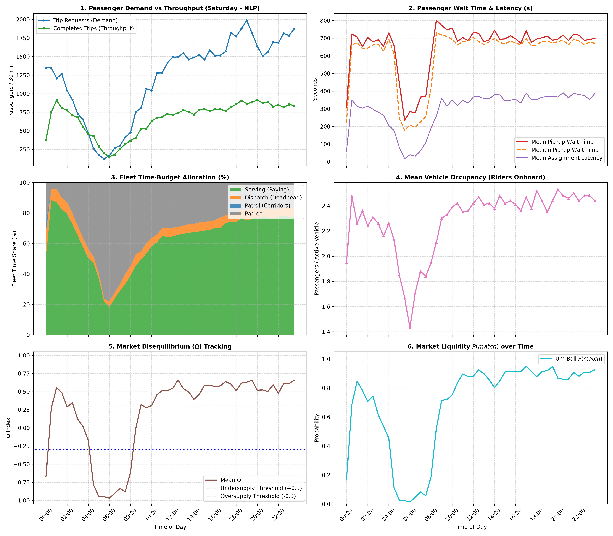

# 📊 24-Hour Macro Periods Summary: Saturday (NLP)

| Time Period | Requests | Completed | Service % | Avg Wait (s) | Serving % | Deadhead % | Mean $\Omega$ | Mean $P(match)$ |
| :--- | :---: | :---: | :---: | :---: | :---: | :---: | :---: | :---: |
| **Late Night (00:00 - 06:00)** | 9,533 | 6,922 | 72.6% | 598.9 s | 61.7% | 7.6% | -0.120 | 0.475 |
| **Morning Rush (06:00 - 10:00)** | 4,252 | 2,732 | 64.3% | 526.5 s | 36.5% | 5.6% | -0.451 | 0.294 |
| **Midday Steady (10:00 - 16:00)** | 17,064 | 8,769 | 51.4% | 709.1 s | 65.4% | 5.5% | +0.506 | 0.867 |
| **Evening Rush (16:00 - 20:00)** | 13,864 | 6,670 | 48.1% | 698.0 s | 73.8% | 6.0% | +0.600 | 0.919 |
| **Night Leisure (20:00 - 24:00)** | 13,555 | 6,862 | 50.6% | 702.4 s | 77.2% | 5.9% | +0.562 | 0.890 |

