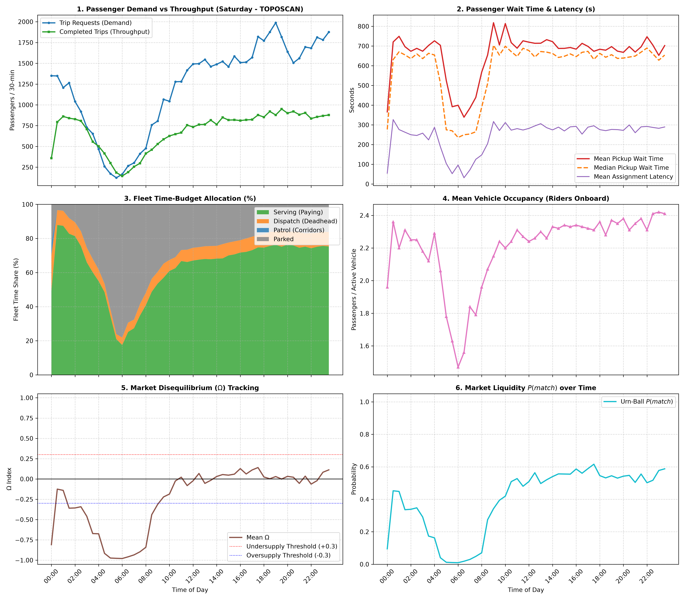

# 📊 24-Hour Macro Periods Summary: Saturday (TOPOSCAN)

| Time Period | Requests | Completed | Service % | Avg Wait (s) | Serving % | Deadhead % | Mean $\Omega$ | Mean $P(match)$ |
| :--- | :---: | :---: | :---: | :---: | :---: | :---: | :---: | :---: |
| **Late Night (00:00 - 06:00)** | 9,533 | 7,154 | 75.0% | 634.7 s | 62.4% | 9.1% | -0.567 | 0.226 |
| **Morning Rush (06:00 - 10:00)** | 4,252 | 2,877 | 67.7% | 538.5 s | 38.1% | 6.5% | -0.698 | 0.148 |
| **Midday Steady (10:00 - 16:00)** | 17,064 | 9,023 | 52.9% | 718.0 s | 67.0% | 7.3% | -0.009 | 0.519 |
| **Evening Rush (16:00 - 20:00)** | 13,864 | 6,933 | 50.0% | 687.8 s | 74.2% | 7.9% | +0.062 | 0.563 |
| **Night Leisure (20:00 - 24:00)** | 13,555 | 7,043 | 52.0% | 692.0 s | 75.3% | 8.3% | +0.018 | 0.542 |

