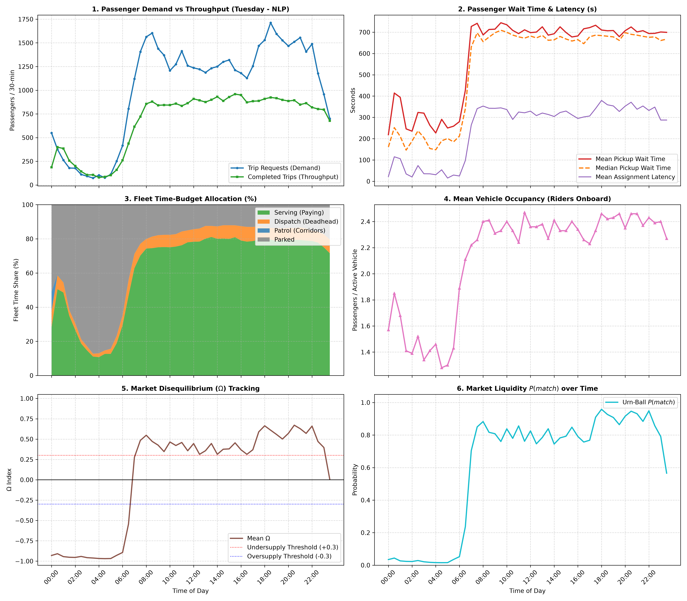

# 📊 24-Hour Macro Periods Summary: Tuesday (NLP)

| Time Period | Requests | Completed | Service % | Avg Wait (s) | Serving % | Deadhead % | Mean $\Omega$ | Mean $P(match)$ |
| :--- | :---: | :---: | :---: | :---: | :---: | :---: | :---: | :---: |
| **Late Night (00:00 - 06:00)** | 2,366 | 2,212 | 93.5% | 286.8 s | 24.0% | 5.2% | -0.949 | 0.025 |
| **Morning Rush (06:00 - 10:00)** | 9,722 | 5,455 | 56.1% | 629.2 s | 63.5% | 7.1% | +0.139 | 0.639 |
| **Midday Steady (10:00 - 16:00)** | 15,110 | 10,682 | 70.7% | 704.3 s | 78.7% | 7.4% | +0.399 | 0.800 |
| **Evening Rush (16:00 - 20:00)** | 11,394 | 7,239 | 63.5% | 707.0 s | 79.3% | 7.5% | +0.497 | 0.860 |
| **Night Leisure (20:00 - 24:00)** | 10,262 | 6,585 | 64.2% | 703.5 s | 77.5% | 7.1% | +0.496 | 0.855 |

