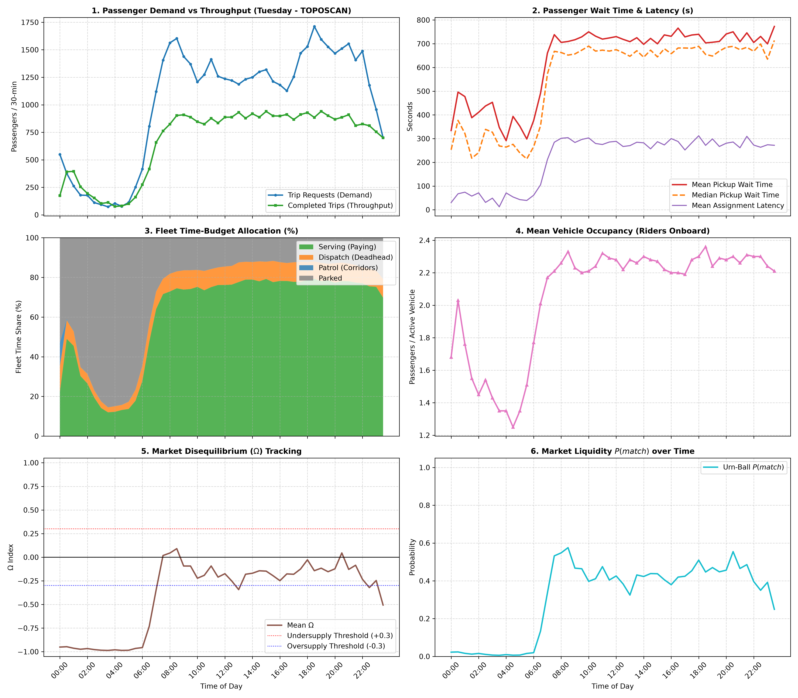

# 📊 24-Hour Macro Periods Summary: Tuesday (TOPOSCAN)

| Time Period | Requests | Completed | Service % | Avg Wait (s) | Serving % | Deadhead % | Mean $\Omega$ | Mean $P(match)$ |
| :--- | :---: | :---: | :---: | :---: | :---: | :---: | :---: | :---: |
| **Late Night (00:00 - 06:00)** | 2,366 | 2,197 | 92.9% | 390.0 s | 23.0% | 6.4% | -0.972 | 0.013 |
| **Morning Rush (06:00 - 10:00)** | 9,722 | 5,635 | 58.0% | 640.9 s | 63.3% | 8.7% | -0.258 | 0.385 |
| **Midday Steady (10:00 - 16:00)** | 15,110 | 10,611 | 70.2% | 722.1 s | 76.9% | 9.3% | -0.194 | 0.413 |
| **Evening Rush (16:00 - 20:00)** | 11,394 | 7,243 | 63.6% | 727.8 s | 78.3% | 9.2% | -0.146 | 0.444 |
| **Night Leisure (20:00 - 24:00)** | 10,262 | 6,564 | 64.0% | 731.7 s | 76.1% | 8.9% | -0.200 | 0.419 |

